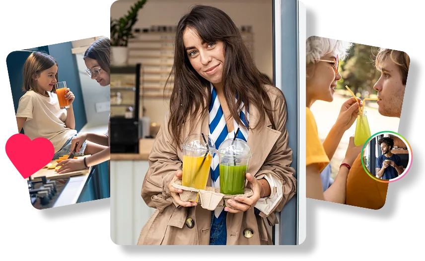
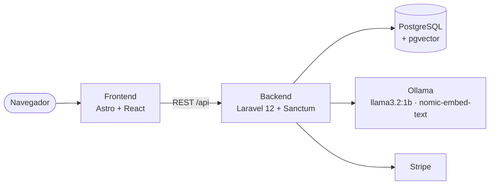

<div align="center">

# 🍹 BlendUs

**La red social para los amantes de los smoothies, con inteligencia artificial integrada.**

Comparte recetas, descubre nuevas combinaciones y deja que la IA te recomiende el batido perfecto para tu estado de ánimo.




</div>

---

## Índice

- [Funcionalidades](#-funcionalidades)
- [Arquitectura](#-arquitectura)
- [Puesta en marcha](#-puesta-en-marcha)
- [Cuentas de prueba](#-cuentas-de-prueba)
- [Tests](#-tests)
- [Pagos con Stripe](#-pagos-con-stripe)
- [Despliegue](#-despliegue)
- [Estructura del proyecto](#-estructura-del-proyecto)

---

## ✨ Funcionalidades

| | Funcionalidad | Descripción |
|---|---|---|
| 🥤 | **Comunidad** | Feed infinito de recetas con foto, ingredientes y pasos. Likes, comentarios, guardados y seguidores. |
| 🎯 | **Feed "Para ti"** | Ranking personalizado mediante *embeddings*: aprende de tus likes y guardados para recomendarte lo que más te gusta. |
| 🍷 | **Sommelier IA** | Describe cómo te sientes y el Chef Enrique te sugiere el smoothie ideal. |
| ✨ | **Generador de recetas** | Escribe una idea y la IA crea la receta completa: título, ingredientes y preparación. |
| 👨‍🍳 | **Asistente de cocina** | Guía interactiva paso a paso para preparar tus smoothies en tiempo real. |
| 💬 | **Mensajería** | Chats privados y grupos, con una interfaz optimizada para móvil. |
| 🛒 | **Marketplace** | Tienda de productos con pago seguro mediante Stripe Checkout. |
| 📱 | **Diseño responsive** | *Mobile first*: menús y navegación pensados para el móvil. |

---

## 🏗 Arquitectura



| Capa | Tecnología |
|---|---|
| **Frontend** | Astro 5 (SSR) con islas de React 19, nanostores para el estado global |
| **Backend** | Laravel 12 (API REST), autenticación con Sanctum (tokens *bearer*) |
| **Base de datos** | PostgreSQL con la extensión pgvector para la búsqueda por similitud |
| **IA** | Ollama ejecutado en local: `llama3.2:1b` para generar texto y `nomic-embed-text` para los embeddings |
| **Pagos** | Stripe Checkout con webhooks firmados |
| **Infraestructura** | Docker Compose para el desarrollo; Vercel, Render y Neon para la demo pública |

---

## 🚀 Puesta en marcha

**Requisitos:** [Docker Desktop](https://www.docker.com/products/docker-desktop/). Nada más: el frontend, el backend, la base de datos y la IA se ejecutan en contenedores.

**1. Arranca todo**

```bash
docker compose up -d
```

En el primer arranque el backend crea la base de datos, carga los datos de ejemplo y empieza a descargar los modelos de IA (~1,6 GB) en segundo plano.

**2. Genera los embeddings** *(solo la primera vez, cuando hayan terminado de descargarse los modelos)*

```bash
docker exec blendus-backend php artisan smoothies:generate-embeddings
```

**3. Abre la aplicación**

| Servicio | URL |
|---|---|
| Frontend | <http://localhost:4321> |
| API | <http://localhost:8000> |

<details>
<summary><b>Reiniciar los datos desde cero</b></summary>

```bash
docker exec blendus-backend php artisan migrate:fresh --seed
```

</details>

---

## 👤 Cuentas de prueba

| Email | Contraseña |
|---|---|
| `test@example.com` | `password` |
| `nico@test.com` | `password123` |
| `paco@test.com` | `password123` |

También puedes iniciar sesión con el nombre de usuario (por ejemplo, `nico`).

---

## 🧪 Tests

**Backend (PHPUnit):** tests de funcionalidad de autenticación, posts, interacciones, chats, marketplace e IA.
Usan una base de datos separada (`blendus_test`), así que nunca tocan tus datos de desarrollo.

```bash
docker exec postgres createdb -U blendus blendus_test   # solo la primera vez
docker exec blendus-backend php artisan test
```

**End-to-end (Playwright + Microsoft Edge):** recorren la aplicación real en el navegador, en escritorio y en móvil.
Necesitan que la aplicación esté arrancada.

```bash
cd e2e
npm install
npm test              # sin interfaz
npm run test:ui       # modo interactivo, para ver los tests en tiempo real
npm run report        # informe HTML de la última ejecución
```

---

## 💳 Pagos con Stripe

El marketplace funciona con Stripe en **modo de prueba**.

1. Copia tus claves del [panel de Stripe](https://dashboard.stripe.com/test/apikeys) en `smoothies-api/.env`:
   `STRIPE_KEY` (clave publicable) y `STRIPE_SECRET` (clave secreta).
2. Para confirmar los pagos en local, instala la [Stripe CLI](https://stripe.com/docs/stripe-cli) y ejecuta:
   ```bash
   stripe login
   stripe listen --forward-to localhost:8000/api/stripe/webhook
   ```
   Copia el *webhook signing secret* que muestra (`whsec_...`) en `STRIPE_WEBHOOK_SECRET`.
3. Compra cualquier producto con la tarjeta de prueba `4242 4242 4242 4242` (cualquier fecha futura y CVC).

---

## 🌍 Despliegue

La demo pública se despliega **gratis y sin tarjeta de crédito**:

| Parte | Servicio |
|---|---|
| Frontend | Vercel |
| API | Render |
| Base de datos | Neon |

> **La demo online no incluye la IA.** Los modelos de Ollama necesitan más memoria de la que ofrece cualquier hosting gratuito,
> así que el Sommelier, el generador de recetas, el asistente de cocina y el feed personalizado muestran un aviso explicándolo.
> El resto de la aplicación funciona igual. Para probar la IA, ejecuta el proyecto en local con Docker.

La guía paso a paso está en [DEPLOY-FREE.md](DEPLOY-FREE.md).

---

## 📁 Estructura del proyecto

```
BlendUs/
├── blendus-frontend/     # Astro + React (páginas, componentes y recursos estáticos)
├── smoothies-api/        # API de Laravel (controladores, servicios, migraciones, seeders y tests)
│   ├── Dockerfile        # Imagen de producción (Render)
│   └── Dockerfile.dev    # Imagen de desarrollo (docker-compose.yml)
├── e2e/                  # Tests end-to-end con Playwright
├── docker-compose.yml    # Entorno de desarrollo
└── DEPLOY-FREE.md        # Guía de despliegue
```
